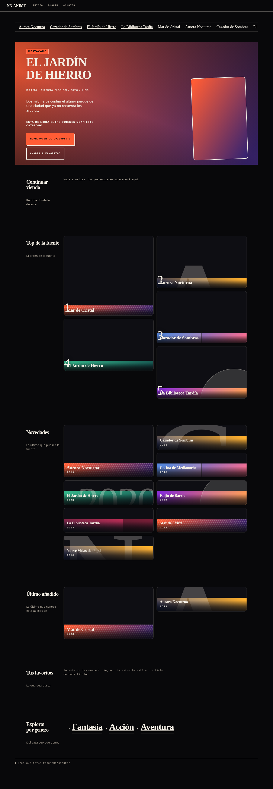
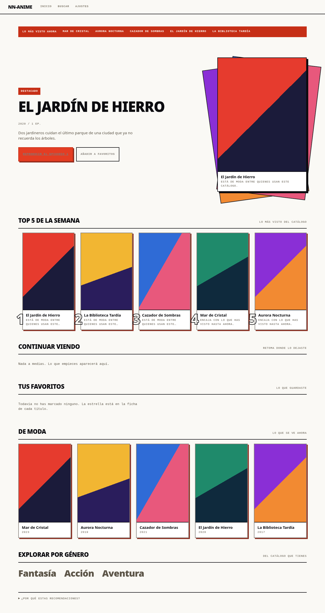

# nn-anime

Ver anime desde el navegador, con una interfaz que se lanza desde la terminal —como `ani-cli`— y que
aprende de lo que ves para recomendarte. Todo local: **no hay servidor central, ni cuentas, ni
telemetría.**





> Las capturas son del arnés de pruebas, con el plugin de ejemplo y sus datos inventados. Las portadas
> son los degradados del diseño porque el fixture apunta a `fixture.invalid`, que no existe. Se pueden
> volver a hacer con `bun run captura` y el servidor del e2e levantado: el comando saca las dos, en
> tema oscuro y claro.

El tema por defecto es el del sistema; se cambia en **Ajustes** y queda guardado.

La home sigue el orden del diseño: cinta de lo más visto, cartel de destacado —con el botón que
reproduce el primer episodio y el de favoritos—, top de la semana con sus motivos, **novedades** de la
fuente, **último añadido**, continuar viendo, favoritos, tendencias y los géneros del catálogo.

Las dos filas del medio existen para que la primera pantalla no dependa de que hayas buscado antes:
«último añadido» enseña lo que la aplicación ya conoce —lo que buscaste y lo que abriste— y
«novedades» se llena con lo que publica tu proveedor si declara `feed`. El destacado también las usa
como reserva: sin nada que recomendar, sale de ahí en vez de dejar la página con un titular.

**La parrilla semanal de estrenos y la fila de episodios nuevos siguen sin estar**: las dos necesitan
una fecha de emisión por episodio, y un feed da la fecha de **publicación del título**, que no es lo
mismo. Se enseña lo que sí se sabe en vez de inventar fechas.

## Arrancar

```bash
bun install
bun run dev          # interfaz en desarrollo, con recarga
bun run start        # servidor real en 127.0.0.1, abre el navegador
```

`bun run start` levanta el servidor en `127.0.0.1`, imprime una dirección con un **token de arranque**
de un solo uso y la abre en el navegador. Sin ese token no se entra: es lo que impide que cualquier
página del navegador hable con tu aplicación local.

No hay ningún proveedor instalado de fábrica. Hasta que copies uno —ver
[la guía de plugins](docs/providers.md)— la aplicación arranca, se ve y no encuentra nada.

## Comandos

| Comando | Qué hace |
|---|---|
| `bun run dev` | Interfaz en desarrollo, con recarga en caliente |
| `bun run start` | Servidor real en `127.0.0.1`, abre el navegador |
| `bun run build` | Construye **la interfaz** en `packages/web/dist` |
| `bun test` | Todas las pruebas, sin red |
| `bun run e2e` | Pruebas en un navegador de verdad, con el plugin de ejemplo |
| `bun run e2e:fallo` | El mismo arnés con el proveedor en modo fallo |
| `bun run typecheck` | `tsc --noEmit` sobre todos los paquetes |
| `bun run lint` | Biome |
| `bun run db:migrate` | Crea o actualiza la base |
| `bun run db:prune` | Limpia lo viejo |
| `bun run coverage:gate` | Cobertura por paquete, con su umbral |
| `bun run captura` | Vuelve a hacer la captura de este README |

**Qué produce `bun run build`:** la interfaz. El servidor y el CLI **se ejecutan desde el código fuente
con Bun** y no se compilan a un artefacto: el servidor sirve `packages/web/dist` desde el disco, así que
un binario de un solo archivo tendría que incrustar la interfaz dentro, y eso es trabajo de empaquetado
que v1 no necesita. Requiere Bun en la máquina, y por eso está declarado en `engines`.

## Dónde vive cada cosa

| Qué | Dónde |
|---|---|
| Datos y base de datos | `~/.local/share/nn-anime/` |
| Configuración | `~/.config/nn-anime/` |
| Tus plugins | `~/.config/nn-anime/providers/` |
| Caché | `~/.cache/nn-anime/` |

Las rutas exactas en uso se ven en **Ajustes**, dentro de la aplicación. Se respetan `XDG_DATA_HOME`,
`XDG_CONFIG_HOME` y `XDG_CACHE_HOME`.

## Aviso de seguridad: los plugins se ejecutan sin sandbox

**Un plugin se ejecuta con tus permisos y sin aislamiento.** Puede leer y escribir lo mismo que tú. No
hay sandbox, y no lo habrá en v1: el proceso que carga el plugin es el mismo que sirve la aplicación.

- Copia sólo plugins cuyo origen conozcas.
- La aplicación lo dice **en la pantalla de Ajustes**, no sólo aquí.
- El detalle está en [SECURITY.md](SECURITY.md), con el modelo de amenaza y los riesgos residuales.

## Este repositorio no incluye scrapers

nn-anime **no incluye ningún scraper** de sitios de video, ni torrents, ni protocolos de pares, ni
alojamiento de contenido. Lo que hay es:

- Un **contrato de plugin** (`packages/provider-sdk`) que cualquiera puede implementar.
- Un **plugin de ejemplo** (`packages/providers-fixture`) con doce títulos inventados y direcciones
  `fixture.invalid`, que no existe.
- El motor de recomendación, el proxy, la interfaz y el lanzador.

**Conseguir las fuentes es responsabilidad de quien usa el programa.** Escribe tu propio plugin, o usa
uno que respete las condiciones del sitio del que salen los datos.

## Documentación

| Documento | Qué cuenta |
|---|---|
| [docs/providers.md](docs/providers.md) | Cómo escribir un plugin, con un ejemplo comentado |
| [SECURITY.md](SECURITY.md) | Modelo de amenaza, mitigaciones y riesgos residuales |
| [docs/a11y.md](docs/a11y.md) | Qué se comprueba de accesibilidad y qué no |
| [docs/PLAN-B-HLS.md](docs/PLAN-B-HLS.md) | Por qué HLS se queda en v1 |
| [docs/specs/SPEC-nn-anime.md](docs/specs/SPEC-nn-anime.md) | El spec del proyecto, con las decisiones |
| [docs/specs/CAPABILITY-MAP.md](docs/specs/CAPABILITY-MAP.md) | Qué módulo hace qué |

## Cómo está hecho

Bun y TypeScript en todo el proyecto, React en la interfaz, `bun:sqlite` para los datos y Hono para el
servidor. Los paquetes viven en `packages/`:

- `core` — tipos, esquemas y errores compartidos
- `provider-sdk` — el contrato de plugin y su prueba de conformidad
- `providers-fixture` — el plugin de ejemplo, con datos inventados
- `catalog-store` — la base de datos y sus repositorios
- `media-proxy` — el proxy de bytes y HLS, los tickets opacos y el control de `mpv`
- `recsys` — el motor de recomendación
- `server` — la API
- `web` — la interfaz
- `cli` — el lanzador
