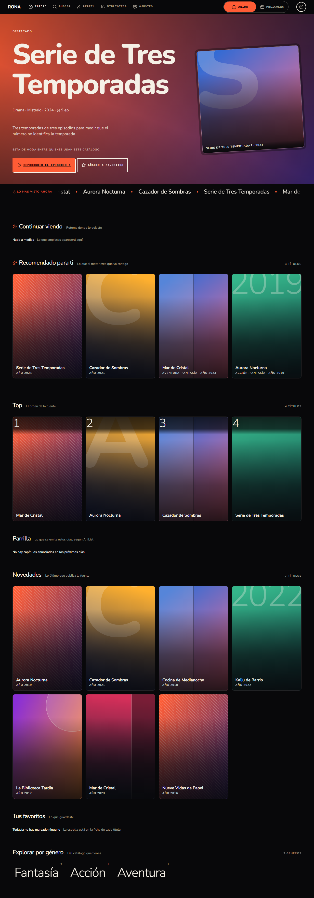

# RoNa

Ver anime desde el navegador, con una interfaz que se lanza desde la terminal —como `ani-cli`— y que
aprende de lo que ves para recomendarte. Todo local: **no hay servidor central, ni cuentas, ni
telemetría.**



> La captura sale del arnés de pruebas —el plugin de ejemplo, con doce títulos inventados y
> direcciones `fixture.invalid`—, así que las portadas son los degradados del diseño y no carátulas
> reales. Se rehace con `bun run captura` y el servidor del e2e levantado. **Se publica un solo
> tema, el oscuro**; el de la aplicación sigue al del sistema y se cambia en **Ajustes**.

## Qué hace

- **La home**, como una cartelera: cinta de lo más visto, cartel de destacado —con el botón que
  reproduce el primer episodio y el de favoritos—, **top** —el ranking de AniList cuando su API
  contesta y el de la fuente cuando no, numerado y con «Mostrar más»—, **parrilla** de estrenos de
  los próximos días, **novedades** —los episodios recién emitidos, o el feed de la fuente—, continuar
  viendo, favoritos y los géneros del catálogo. Todas las piezas son **carteles del mismo tamaño**,
  así que una fila pone seis títulos a la vista y no deja huecos. El motivo de cada recomendación
  viaja con su pieza: se lee en el asomo, al pasar el puntero, y en la hoja que abre el botón «i».
- **Anime a un lado y películas, series y doramas al otro**, con un conmutador que queda en la
  dirección (`?tipo=movies`), así que se puede recargar y compartir. Cada plugin declara en su
  manifiesto qué sirve (`capabilities.media`, ausente es anime): **Ajustes** lo enseña junto a cada
  fuente, y uno que sirva las dos cosas declara `both` y su catálogo se reparte por tipo. Si no hay
  ninguna fuente de esa mitad, la pantalla lo dice en vez de quedarse en blanco.
- **La parrilla y los episodios recién emitidos salen de la API pública de AniList**, la única fuente
  consultada con fecha de emisión por episodio —un feed da la fecha de **publicación del título**, que
  no es lo mismo—. Se consulta `graphql.anilist.co` directamente, con lista blanca de hosts, un
  presupuesto de una petición cada dos segundos y caché con TTL en la base local; sus términos se
  respetan no pidiendo nada que no esté en pantalla. La ficha se enriquece con su sinopsis, sus
  géneros, su nota y su portada cuando la obra está emparejada, y `RONA_ANILIST_OFFLINE=1` apaga
  esa salida (lo usa el arnés de pruebas, que no puede depender de un tercero).
- **TMDB, opcional, para las películas y las series de acción real**, que no están en AniList: una
  clave en **Ajustes** completa su sinopsis, sus géneros y su año. Se guarda en la base local, no se
  devuelve nunca al navegador y sólo se usa contra `api.themoviedb.org`. Sin clave, la ficha se queda
  con lo que publique la fuente. La portada siempre es la del plugin.
- **La ficha** reserva su misma forma mientras carga y pinta desde el primer fotograma lo que la
  tarjeta ya sabía —título, portada, metadatos—, así que no hay salto de altura ni un «cargando» que
  se lo coma. Si el proveedor falla, la tarjeta de error dice qué pasó, de quién es la culpa y ofrece
  **Reintentar**; si la obra no está, lo dice con esas palabras. La primera vez que se abre una obra
  —sin caché— llega también con su banda, sus relaciones y los datos de AniList, sin recargar.
- **Recomendaciones explicables**: el motor sólo mira señales locales —lo que buscaste, lo que
  abriste, lo que puntuaste— y cada sugerencia lleva su motivo. Las **novedades** existen para que la
  primera pantalla no dependa de que hayas buscado antes; cuando no hay nada que recomendar, el
  destacado sale de lo que la aplicación ya conoce en vez de quedarse con un titular.
- **Descargas y biblioteca**: lo que descargas se queda en el equipo y se ve sin pedirle nada al
  proveedor ni a la red —la cola delante, colapsable y con su avance, el total estimado y el tiempo
  que queda—. Se agrupa por título cuando está completo, dice el espacio que ocupa y su reproductor
  encadena los episodios descargados; desde la ficha se apunta la serie entera a la cola. Mientras
  exista, la copia local manda en el reproductor. Si una descarga quedó en segmentos, se dice ahí
  mismo y se pasa a MP4 sin volver a bajar nada, con `ffmpeg` si está y `mux.js` dentro de la
  aplicación si no. La carpeta se elige en **Ajustes**.
- **La guía de primeros pasos** sale sola la primera vez que se entra en cada pantalla: un recorrido
  que señala cada parte y avisos que marcan lo que acaba de llegar. El «?» de la cabecera repite el
  de la pantalla en la que estés, **Ajustes** los lista todos y devuelve los avisos descartados. En
  el móvil la navegación se muda a una **barra inferior**, y la biblioteca, el perfil y los ajustes
  comparten el juego de iconos del resto.
- **Watch party (experimental, apagado por defecto)**: una sala donde varias instancias reproducen
  el mismo episodio a la vez, cada una desde su fuente. Se sincroniza **sólo el estado** —posición,
  pausa y velocidad—, nunca el vídeo. Se enciende con `RONA_PARTY=1`; el anfitrión necesita el
  modo servidor para que la sala se alcance por LAN, y el invitado entra desde su propia instancia.
  Sin servidor central, sin cuentas y sin persistencia.

## Instalación (para usuarios)

**No hace falta instalar nada más**: ni Node, ni Bun, ni Python. Cada descarga trae dentro el
programa entero —la interfaz, el servidor y la base de datos—, y todo está en
[la página de Releases](https://github.com/zxuru/rona/releases).

| Sistema | Archivo |
|---|---|
| Windows x64 | `rona-X.Y.Z-windows-x64.exe` |
| macOS, chip de Apple | `rona-X.Y.Z-macos-arm64.zip` |
| macOS, Intel | `rona-X.Y.Z-macos-x64.zip` |
| Linux x64 | `rona-X.Y.Z-linux-x64.AppImage` |

Todas las entregas son portables: se descargan, se ejecutan y ya está. Ninguna instala nada, deja
accesos ni escribe un desinstalador.

### Windows: un solo archivo

Descarga `rona-X.Y.Z-windows-x64.exe`, ponlo donde quieras y ejecútalo. **No instala nada** y no
deja accesos: el mismo archivo lleva dentro la interfaz, el servidor y la base. Al abrirlo aparece su
ventana, con la aplicación dentro y sin ninguna consola de por medio.

Por defecto los datos —la base, los ajustes, los plugins y el perfil del webview— van a
`%LOCALAPPDATA%\rona-data`, **fuera** de la carpeta del `.exe`, así que sobreviven a moverlo,
borrarlo o actualizarlo. Si prefieres que viajen con él —una memoria USB, una carpeta portátil—, crea
un archivo vacío llamado `portable.txt` **al lado** del ejecutable: entonces todo se guarda ahí (`bin`,
`config`, `cache`, `webview` y la base).

Dos banderas, por si hacen falta:

- `--diagnostico` escribe un informe con las rutas, la versión y el estado del servidor embebido, y lo
  enseña en un diálogo.
- `--navegador` abre la interfaz en el navegador del sistema en vez de en la ventana.

### La ventana y la bandeja

Al abrir el ejecutable aparece **su ventana**, con la interfaz dentro: no hay ninguna consola de por
medio. **La X la oculta en la bandeja**; «Salir» cierra la aplicación, apaga el servidor y no deja
ningún proceso vivo. Mientras la ventana está oculta, el icono sigue ahí para volver a abrirla.

Windows avisará de que el programa viene de un **desarrollador no verificado** mientras la release no
esté firmada. En «Más información» del aviso está «Ejecutar de todas formas»: el aviso es de que nadie
ha pagado un certificado, no de que el archivo esté mal. El `SHA256SUMS.txt` de la release sirve para
comprobar que llegó entero.

### Actualizaciones

La aplicación comprueba si hay una versión nueva **una vez, al arrancar**, y también cuando
pulsas **Buscar actualizaciones** en el icono de la bandeja. **Sólo en Windows**: es la única
plataforma que publica un manifiesto del updater (`latest.json`). En macOS y Linux la misma ventana
existe y lo dice, con el enlace a la release para descargar la versión nueva a mano. Si hay una
versión nueva, la ventana de actualizaciones enseña el número de versión y las notas. No descarga
nada hasta que pulsas **Actualizar ahora**. Al aceptar, descarga el `.exe` nuevo, verifica su firma
minisign y lo reemplaza **en sitio**: aparta el que está corriendo, pone el nuevo, arranca la versión
nueva y borra el viejo. Si la release no trae ese `.exe` firmado, se queda el aviso con el enlace a
la release. Si el medio es de sólo lectura o el reemplazo falla, pasa lo mismo.

Tus datos nunca viajan dentro del `.exe`: la base, los ajustes y los plugins viven en
`%LOCALAPPDATA%\rona-data` —o en la carpeta del ejecutable si hay un `portable.txt`—, así que
mover, borrar o actualizar el archivo no los toca.

**La release puede salir sin firma de código.** Los certificados de Windows y macOS son opcionales:
sin ellos la release se publica igualmente, sin firmar, y el sistema avisa —«desarrollador no
verificado» en Windows y la cuarentena de Gatekeeper en macOS, con los pasos de las secciones de
abajo—. La ventana de actualizaciones lo dice en su nota. Eso no toca la firma del updater, que es
otra y sí es obligatoria: es la que impide instalar un ejecutable que no venga de esta release.

### macOS

Descomprime el `.zip` y mueve **RoNa** a la carpeta que quieras —Aplicaciones o cualquier otra—.
Hay un `.zip` por arquitectura: `arm64` para los Mac con chip de Apple y `x64` para los Intel. Cuál es
el tuyo se ve en el menú Apple → «Acerca de este Mac».

Mientras la release no esté firmada ni notarizada, macOS la frena la primera vez con «no se puede
abrir porque proviene de un desarrollador no identificado». Para abrirla:

- **Botón derecho sobre la aplicación → Abrir** y, en el diálogo, **Abrir**. Sólo hace falta la
  primera vez.
- Si esa opción no aparece: **Ajustes del Sistema → Privacidad y seguridad** y, abajo, **«Abrir de
  todos modos»**.

La aplicación abre **su propia ventana**, con la interfaz dentro, y deja su icono en el Dock. La
ventana y la bandeja funcionan como en Windows: **la X la oculta** y «Salir» la cierra.

### Linux

Descarga el **AppImage**, dale permiso de ejecución y lánzalo:
`chmod +x rona-X.Y.Z-linux-x64.AppImage && ./rona-X.Y.Z-linux-x64.AppImage`. No instala nada
ni toca el sistema.

Sin argumentos abre **la ventana**, sin ninguna terminal de por medio, y la bandeja funciona como en
Windows. Con argumentos ejecuta la consola; el `AppImage` hace las dos cosas.

### Comprobar la descarga

Cada release lleva un `SHA256SUMS.txt` con el hash SHA256 de todos sus archivos:

```bash
sha256sum -c SHA256SUMS.txt
```

En Windows, `certutil -hashfile <archivo> SHA256` y se compara a ojo.

### Después de instalar

**No hay ningún proveedor instalado de fábrica**, así que la aplicación arranca, se ve y no encuentra
nada. Para que encuentre algo hay que copiar un plugin, y eso se cuenta en
[la guía de plugins](docs/providers.md): sin plugins no hay búsqueda, ni catálogo, ni recomendaciones,
sólo la interfaz y el motor.

La primera vez, **Ajustes ya trae escrito el repositorio recomendado**
—[nn-anime-plugins](https://github.com/zxuru/nn-anime-plugins)—: se añade, se miran sus archivos y se
marcan los que se quieran. Añadirlo no ejecuta nada; marcar un proveedor es lo que ejecuta su código.

Esa primera vez, **la guía** acompaña pantalla por pantalla y se puede saltar en cualquier momento;
**Ajustes** la repite cuando haga falta.

Si tienes `mpv` instalado, la aplicación lo detecta al arrancar y ofrece reproducir en él además de en
el navegador. No hace falta para nada.

## Arrancar

```bash
bun install
bun run build        # construye la interfaz, que es lo que sirve `bun run start`
bun run start        # servidor real en 127.0.0.1, abre el navegador
```

`bun run start` sirve `packages/web/dist` desde el disco, así que **sin `bun run build` la interfaz no
está**: el servidor arranca y contesta 404 en `/`. Para desarrollar la interfaz con recarga en caliente
está `bun run dev`, que sirve el código fuente y no necesita el `build`.

`bun run start` levanta el servidor en `127.0.0.1`, imprime una dirección con un **token de arranque**
de un solo uso y la abre en el navegador. Sin ese token no se entra: es lo que impide que cualquier
página del navegador hable con tu aplicación local.

En `bun run dev` esa dirección es **reutilizable mientras el proceso viva**: el mismo enlace abre la
aplicación en otro navegador o en otro perfil, y cada uno recibe su propia cookie. Además,
`127.0.0.1:5173` entra sola: si el navegador no tiene una sesión vigente, Vite lo lleva a una entrada
que emite una cookie nueva, incluso al abrir un enlace profundo. Es una comodidad **sólo de
desarrollo**: fuera de `bun run dev` ni la entrada ni el token reutilizable existen, y el arranque
normal sigue siendo de un solo uso y caduca a los cinco minutos.

Si vas a contribuir, `bun run hooks:instalar` una vez por clon: instala el gancho que frena el commit
directo en `main`, y hay una prueba que comprueba que está puesto.

**En Windows** funciona igual, con dos particularidades. Bun no define `HOME` ahí, así que los datos
van a `%LOCALAPPDATA%` y la configuración a `%APPDATA%` en lugar de a las rutas de XDG. Y dos pruebas
que crean enlaces simbólicos necesitan el **modo desarrollador** activado: sin él Windows las rechaza
con `EPERM` y las pruebas lo declaran en lugar de fingir que midieron.

## Presencia en Discord (opcional)

RoNa puede publicar en tu perfil de Discord que estás viendo algo, con la app «RoNa»
(`Application ID` `1571721886742876321`). Está **apagada por defecto** y se enciende en **Ajustes →
Presencia en Discord**:

| Modo | Qué publica |
|---|---|
| Apagada | Nada. Es el valor inicial. |
| Discreta | «Viendo en RoNa» y el tiempo; ni título ni episodio. |
| Completa | El título y el número de episodio. |

Un título marcado para adultos no se publica en ningún modo: el servidor lo resuelve, lo cruza con
la marca local y manda el texto genérico. No hay OAuth, ni token, ni `client_secret`: el servidor
habla con el IPC local del cliente de Discord y sólo manda la actividad. Para que salga el icono,
sube `packaging/icons/icon-1024.png` al portal de Discord con la clave `rona`.

## Docker y servidor

Además del uso local, RoNa se puede desplegar como contenedor en un servidor, un NAS o una LAN:

```bash
docker build -t rona:local .
docker run -d -p 127.0.0.1:8080:8080 \
  -e RONA_TOKEN="$(openssl rand -base64 32)" \
  -v rona-data:/data rona:local
```

La imagen escucha en `0.0.0.0:8080`, guarda todo en `/data` y **no incluye ningún plugin**. Fuera de
loopback exige `RONA_TOKEN`: sin él, el arranque se niega. Con token, la interfaz y la API piden
la cookie que se consigue en `/login`; `/healthz` es lo único público.

**No la expongas a Internet sin token y sin TLS delante.** Los plugins se ejecutan sin sandbox, y
SQLite admite **una sola réplica por volumen**. La guía completa —variables, volúmenes, cómo
instalar plugins, Caddy y actualización— está en [docs/docker.md](docs/docker.md).

## Watch party (experimental)

La sala sincroniza **sólo el estado de reproducción** entre instancias: qué episodio, en qué segundo,
pausado o no. El vídeo no viaja; cada participante lo reproduce desde sus proveedores o sus descargas.
Está apagada por defecto.

**Anfitrión:** escucha en la LAN y enciende la función.

```bash
export RONA_TOKEN="$(openssl rand -base64 32)"
RONA_HOST=0.0.0.0 RONA_PARTY=1 bun run start
```

Abre el episodio, pulsa **Ver juntos** y comparte el código de 16 caracteres y una de las direcciones
que enseña el panel. **Invitado:** arranca su propia instancia con `RONA_PARTY=1`, abre el mismo
episodio, pulsa **Unirse** y escribe la dirección del anfitrión y el código. Su servidor habla con el
del anfitrión; su pestaña no cruza orígenes y no recibe la sesión del anfitrión.

Ocho participantes por sala, cuatro horas de vida, sin persistencia ni servidor central. En LAN sin
TLS el código y el estado viajan sin cifrar: úsalo en una red de confianza, no en Internet. La guía
completa, los límites y lo que falta (WebRTC P2P, coincidencia de contenido) están en
[docs/watch-party.md](docs/watch-party.md).

## Comandos

| Comando | Qué hace |
|---|---|
| `bun run dev` | Interfaz en desarrollo, con recarga en caliente |
| `bun run start` | Servidor real en `127.0.0.1`, abre el navegador |
| `bun run build` | Construye **la interfaz** en `packages/web/dist` |
| `bun test` | Todas las pruebas, sin red |
| `bun run e2e` | Pruebas en un navegador de verdad, con el plugin de ejemplo |
| `bun run e2e:fallo` | El mismo arnés con el proveedor en modo fallo |
| `bun run typecheck` | `tsc --noEmit` sobre todos los paquetes |
| `bun run lint` | Biome |
| `bun run hooks:instalar` | Instala el gancho de git que frena el commit directo en `main` |
| `bun run db:migrate` | Crea o actualiza la base |
| `bun run db:prune` | Limpia lo viejo |
| `bun run coverage:gate` | Cobertura por paquete, con su umbral |
| `bun run captura` | Vuelve a hacer la captura de este README |
| `bun run package` | Compila el ejecutable de esta plataforma; en macOS y Linux arma además su artefacto portable (`.zip` o AppImage). En Windows el portable es `package:unico` |
| `bun run package:unico` | Deja el `.exe` portable de Windows en `release/`; el anfitrión tiene que ser más nuevo que el servidor |
| `bun run package:smoke` | Arranca un ejecutable ya compilado y le pregunta si sirve la interfaz |
| `bun run desktop:build` | Compila el anfitrión de ventana (y antes su ventana de actualizaciones); `--target=darwin-x64` lo compila cruzado |
| `bun run desktop:ui` | Compila `desktop/ui/actualizacion.ts` al JavaScript que viaja dentro del binario |
| `bun run desktop:check` | El listón del árbol de Rust: formato, `clippy` y sus pruebas |
| `bun run version:check` | Comprueba que los diez `package.json` dicen la misma versión |
| `bun run version:set` | Sube la versión en los diez `package.json` de una vez |
| `bun run icon` | Vuelve a generar el icono (PNG, ICO e ICNS) desde código |

**Qué produce `bun run build`:** la interfaz. El servidor y el CLI **se ejecutan desde el código
fuente con Bun** para desarrollar, y `bun run package` es lo que los convierte en un programa
portable: un ejecutable por plataforma que lleva dentro el runtime, la interfaz y las migraciones.
Para desarrollar hace falta Bun en la máquina —y por eso está declarado en `engines`—; para **usar**
la aplicación descargada, no hace falta nada.

## Dónde vive cada cosa

| Qué | Linux y macOS | Windows |
|---|---|---|
| Datos y base de datos | `~/.local/share/rona/` | `%LOCALAPPDATA%\rona\` (CLI) · `%LOCALAPPDATA%\rona-data\` (ventana) |
| Copias de seguridad | `~/.local/share/rona/backups/` | `%LOCALAPPDATA%\rona\backups\` · `%LOCALAPPDATA%\rona-data\backups\` |
| Configuración | `~/.config/rona/` | `%APPDATA%\rona\` |
| Tus plugins | `~/.config/rona/providers/` | `%APPDATA%\rona\providers\` |
| Repositorios de proveedores descargados | `~/.local/share/rona/repos/` | `%LOCALAPPDATA%\rona\repos\` |
| Caché | `~/.cache/rona/` | `%LOCALAPPDATA%\rona\cache\` |
| Descargas (por defecto) | `~/.local/share/rona/downloads/` | `%LOCALAPPDATA%\rona\downloads\` |

La tabla es la del **CLI** (`bun run start`). La **ventana** fija los tres directorios bajo una sola
raíz: `%LOCALAPPDATA%\rona-data` en Windows —hermana de la carpeta que usaban las versiones
instaladas, para que la actualización no comparta sitio con la base— y `~/.local/share/RoNa` —o
`XDG_DATA_HOME`— en macOS y Linux, con `config`, `cache`, `bin` (el servidor), `webview` y `backups`
dentro. Las instalaciones anteriores de Windows guardaban los datos dentro de `%LOCALAPPDATA%\RoNa`
y se trasladan una sola vez al arrancar. En modo portable (`portable.txt`) esa raíz es la carpeta del
`.exe`. Las rutas exactas en uso se ven en **Ajustes**, dentro de la aplicación.

Las variables de entorno que lee la aplicación están inventariadas en `.env.example`, sin ningún valor
real. En el uso local ninguna es obligatoria y ninguna lleva un secreto: los directorios se pueden
cambiar por ahí, y también `RONA_LANG` para el idioma. En modo servidor, `RONA_TOKEN` **es
obligatorio fuera de loopback y es un secreto**: no se escribe en `.env.example`, se pone en el entorno
del despliegue o en un `.env` local. Copiar el archivo a `.env` es opcional; Bun lo carga solo.

## Aviso de seguridad: los plugins se ejecutan sin sandbox

**Un plugin se ejecuta con tus permisos y sin aislamiento.** Puede leer y escribir lo mismo que tú. No
hay sandbox, y no lo habrá en v1: el proceso que carga el plugin es el mismo que sirve la aplicación.

- Copia sólo plugins cuyo origen conozcas.
- La aplicación lo dice **en la pantalla de Ajustes**, no sólo aquí.
- El detalle está en [SECURITY.md](SECURITY.md), con el modelo de amenaza y los riesgos residuales.

En **Ajustes** hay además una sección para traer los proveedores de un repositorio de GitHub: se pega
la dirección, se mira qué trae y se marca cuáles se activan. Instalar **no ejecuta nada** —el
repositorio se descarga y sus archivos se leen, no se importan—; marcar una casilla es el momento en
que ese código se ejecuta, con el mismo aviso de arriba delante. El repositorio entero queda en
`repos/` y los archivos marcados se cargan desde ahí, así que un proveedor que importe un archivo
hermano sigue funcionando.

## Este repositorio no incluye scrapers

RoNa **no incluye ningún scraper** de sitios de video, ni torrents, ni protocolos de pares, ni
alojamiento de contenido. Lo que hay es:

- Un **contrato de plugin** (`packages/provider-sdk`) que cualquiera puede implementar.
- Un **plugin de ejemplo** (`packages/providers-fixture`) con doce títulos inventados y direcciones
  `fixture.invalid`, que no existe.
- El motor de recomendación, el proxy, la interfaz y el lanzador.

**Conseguir las fuentes es responsabilidad de quien usa el programa.** Escribe tu propio plugin, o usa
uno que respete las condiciones del sitio del que salen los datos.

Los proveedores que escribimos para sitios reales no viven aquí, viven en su propio repositorio:
[nn-anime-plugins](https://github.com/zxuru/nn-anime-plugins). Se copian a
`~/.config/rona/providers/` y la aplicación los carga al arrancar. La separación es deliberada: es
lo que permite que este repositorio siga sin incluir un solo scraper.

## Cómo está hecho: el stack

Todo es **Bun** y **TypeScript**, en un monorepo de nueve paquetes. Cada fila de la tabla es una
dependencia que se declara en algún `package.json` del repositorio, no una intención:

| Capa | Qué se usa |
|---|---|
| Runtime y ejecutables | **Bun 1.4+** para correr, probar y compilar; `bun build --compile` deja un ejecutable autocontenido por plataforma, con el runtime, el servidor, SQLite y la interfaz dentro |
| Lenguaje | **TypeScript 7** en modo `strict`, con `noUncheckedIndexedAccess`; sin `any` implícito ni `@ts-ignore` |
| Interfaz | **React 19** y **Vite 8**; CSS propio con tokens, Nunito autoalojada —sin CDN—, `hls.js` para HLS, `mux.js` para remezclar a MP4 sin ffmpeg, `driver.js` para la guía y `lucide-react` para los iconos |
| Servidor | **Hono 4** sobre Bun; API HTTP y eventos SSE, token de arranque de un solo uso y proxy con lista blanca de destinos |
| Datos | **SQLite con `bun:sqlite`**: una base local con migraciones, metadatos con TTL, favoritos, historial, progreso y ajustes. **zod 4** valida en las fronteras |
| Vídeo | Proxy de bytes y HLS con reescritura de playlists y tickets opacos; `mpv` opcional, detectado al arrancar |
| Recomendación | Motor propio en `recsys` —afinidad, covisitas y MMR— que devuelve el motivo junto a cada sugerencia |
| Escritorio | **Tauri 2** con **Rust**, en `desktop/`: lanza el lanzador como proceso hermano, abre la ventana en su dirección y lo cierra al salir |
| Calidad | `tsc --noEmit`, **Biome 2** para estilo y formato, **`bun test`** sin red y **Playwright** para el e2e, con umbral de cobertura por paquete |
| Publicación | **release-please** sobre Conventional Commits y **GitHub Actions**; artefactos portables —`.exe` único, `.zip` del `.app` y AppImage—; firma minisign y `SHA256SUMS.txt` |

Los paquetes de `packages/`, y para qué existe cada uno:

- `core` — tipos, esquemas, errores, configuración y resultado tipado; sin dependencias
- `provider-sdk` — el contrato de plugin y su prueba de conformidad
- `providers-fixture` — el plugin de ejemplo, con datos inventados
- `catalog-store` — la base de datos y sus repositorios
- `media-proxy` — el proxy de bytes y HLS, los tickets opacos y el control de `mpv`
- `recsys` — el motor de recomendación
- `server` — la API, composición HTTP de los módulos
- `web` — la interfaz
- `cli` — el lanzador

Una regla que el stack respeta: **la interfaz no importa código del servidor**, sólo consume su
superficie HTTP, igual que la ventana de escritorio. Por eso el frontend se puede abrir en un
navegador cualquiera y la ventana sólo añade el anfitrión.

Y fuera de `packages/`, en `desktop/`, vive el **anfitrión de ventana** —Rust y Tauri—. Está fuera del
monorepo a propósito: así `tsc`, `bun test` y Biome no miran un árbol que no es suyo. Tiene su propio
listón en `bun run desktop:check`, que corre el CI, y su contrato está en
[docs/specs/SPEC-desktop.md](docs/specs/SPEC-desktop.md).

## Cómo publicar una release (para mantenedores)

La versión vive **en un solo sitio**: `package.json` de la raíz. Los otros nueve manifiestos la
copian, y `bun run version:check` falla si alguno se desvió —lo que impide publicar un binario que
dice una versión y unos artefactos que dicen otra—.

1. **Deja que el PR de release se abra solo.** `release-please` lee los Conventional Commits
   (`feat:`, `fix:`…) que ya se escriben en `main`, y mantiene un PR con el `CHANGELOG.md` escrito y
   la versión subida en los diez `package.json`. Se titula «chore(main): release X.Y.Z».
2. **Fusiona ese PR.** Al fusionarlo, `release-please` crea el tag `vX.Y.Z` y deja la release **en
   borrador**, con el changelog como cuerpo.
3. **El resto lo hace el workflow.** El tag dispara `.github/workflows/release.yml`, que pasa el
   listón (tipos, estilo, auditoría y pruebas), compila **el `.exe` único de Windows**, los dos `.zip`
   de macOS y el AppImage de Linux, calcula el `SHA256SUMS.txt`, sube todo al borrador y **lo
   publica**. Es el único workflow que publica.

No hay que tocar nada a mano, **salvo la primera vez**: no hay ningún tag del que partir, así que
`v0.1.0` se crea a mano (`git tag -a v0.1.0 -m "RoNa 0.1.0" && git push origin v0.1.0`) y desde
ahí `release-please` lleva el resto. Para probar la cadena de empaquetado sin publicar está
**Actions → Release → Run workflow** con «publish» sin marcar: compila todo y deja los artefactos en
el resumen del workflow, sin gastar un número de versión. Si hay que subir la versión a mano —un
`hotfix` sin commits que lo justifiquen—: `bun run version:set 0.2.1`, commit, y el tag `v0.2.1` a
mano.

**Compila GitHub, no tu máquina.** Cada push compila el ejecutable y sus artefactos portables en las
tres plataformas y los deja descargables en «Artifacts», para que no haga falta un Mac ni ninguna
herramienta de empaquetado a mano. El detalle —secretos de firma, el ajuste que necesita
`release-please` y qué queda por probar— está en [la guía de publicación](docs/release.md). Sin
ningún secreto, las releases salen **sin firmar** y se ejecutan igual, con las advertencias del
sistema que cuenta la sección de instalación.

## Documentación

| Documento | Qué cuenta |
|---|---|
| [docs/providers.md](docs/providers.md) | Cómo escribir un plugin, con un ejemplo comentado |
| [docs/marca.md](docs/marca.md) | La marca: la R-raposa, sus dos tamaños y cómo se regenera |
| [docs/docker.md](docs/docker.md) | Docker, NAS y LAN: variables, volúmenes, plugins, Caddy y actualización |
| [docs/watch-party.md](docs/watch-party.md) | La sala de visionado: cómo se enciende, límites, seguridad y lo que falta |
| [docs/release.md](docs/release.md) | Cómo se publica: secretos de firma, ajustes del repositorio y qué queda por probar |
| [SECURITY.md](SECURITY.md) | Modelo de amenaza, mitigaciones y riesgos residuales |
| [docs/a11y.md](docs/a11y.md) | Qué se comprueba de accesibilidad y qué no |
| [docs/PLAN-B-HLS.md](docs/PLAN-B-HLS.md) | Por qué HLS se queda en v1 |
| [docs/specs/SPEC-rona.md](docs/specs/SPEC-rona.md) | El spec del proyecto, con las decisiones |
| [docs/specs/CAPABILITY-MAP.md](docs/specs/CAPABILITY-MAP.md) | Qué módulo hace qué |
| [docs/estudio-busqueda-ani-cli-mx.md](docs/estudio-busqueda-ani-cli-mx.md) | Cómo busca ani-cli-mx —anime y películas—, en qué se diferencia de RoNa y la receta para los plugins |
| [docs/estudio-tauri.md](docs/estudio-tauri.md) | La ventana propia encima de lo que ya se empaqueta: qué falta, qué se midió y en qué orden |
