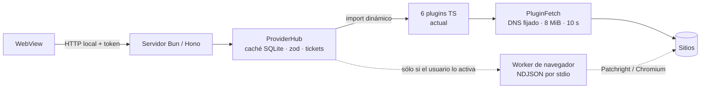

# ¿Merece la pena migrar el scraper de nn-anime a Scrapling?

Análisis de la migración del scraping actual a [Scrapling](https://github.com/D4Vinci/Scrapling).
**Sólo análisis**: no se modificó código, no se instaló nada en el proyecto y no hay commits.
Los números del PoC se midieron en un directorio temporal fuera del repositorio y se borraron al terminar.

Fecha: 8 de noviembre de 2026. Versión de Scrapling verificada: **0.5.1** (2026-11-04).

---

## 1. Resumen ejecutivo y recomendación

**Recomendación: no migrar el scraper a Scrapling.** Ni completo ni como dependencia de la aplicación.
Scrapling es una buena librería, pero **no resuelve el problema que tiene este scraper** y el precio de
meter un segundo runtime en un `.exe` único de Tauri es desproporcionado.

El razonamiento, en cinco puntos:

1. **El scraper actual no falla por parsear HTML.** De los seis proveedores reales, cuatro hablan JSON
   o GraphQL (animex, animeav1, cuevana3, y el paginador de jkanime) y su parte frágil es *el acceso*
   —dominios que se mudan, tokens atados al `User-Agent`, `Referer`, CSRF, un 429—, no el selector.
   Scrapling mejora el parseo, que es justo lo que aquí menos duele.
2. **Donde Scrapling sí aportaría —navegador real para resolver streams detrás de Cloudflare/JS— no es
   gratis**: 238 MB de entorno virtual con `[fetchers]` medidos, más ~281 MB de Chromium, más un intérprete Python que
   hoy no existe en la app; y el proyecto vende un `.exe` único sin Node, sin Bun y sin Python
   ([README](../README.md#L68)). El delta estimado del instalador es de **+120 a +200 MB** y en disco
   **+450 a +600 MB**.
3. **La integración choca con decisiones ya tomadas**: los plugins son archivos `.ts` que se copian a
   mano y se cargan con `import()` en el mismo proceso, sin sandbox; todo el tráfico sale por
   `PluginFetch`, que resuelve el DNS una vez, fija la IP, bloquea loopback/privadas/metadata y corta a
   8 MiB y 10 s ([`plugin-net.ts`](../packages/core/src/plugin-net.ts),
   [`plugin-fetch.ts`](../packages/media-proxy/src/plugin-fetch.ts)). Un proceso Python con
   `curl_cffi`/Chromium **se salta esa puerta**: es la parte del diseño que más se perdería.
4. **El riesgo de mantenimiento es alto para una app de escritorio**: Scrapling está en *beta*, con 55
   releases en dos años y **parches que rompen API** (0.4.15 y 0.5.1), Windows fuera de su CI, y el
   navegador va por un *fork* parcheado (Patchright). Una integración escrita hoy se puede romper sin
   cambiar de versión menor.
5. **Hay un camino más barato para el mismo hueco.** El PoC encontró un fallo real del scraper actual
   (pierde un título porque su slug lleva puntos: 22/23 tarjetas frente a 23/23 con CSS) y una mejora de
   robustez de parseo cuesta ~9 MB en TypeScript, no 500 MB en Python. Y si algún día hace falta
   navegador, el ecosistema TS ya tiene Patchright (`npm`) y el repo ya usa Playwright para e2e: el
   worker se puede escribir en TypeScript y evitar el segundo lenguaje.

**Qué haría en su lugar** (coste bajo, sin tocar la arquitectura):

- Añadir una capa de parseo estructural para las fuentes HTML (`parse5`/`cheerio`, ~9 MB) o, como
  mínimo, tests con HTML real capturado y saneado (hoy no hay ninguno).
- Manejar `429`/`Retry-After` de forma genérica en el motor (hoy sólo jkanime tiene una pausa de 65 s
  en memoria, que se pierde al reiniciar).
- Medir la fragilidad de verdad: contar fallos por proveedor y por método en la caché/registro, para
  decidir con datos en lugar de con impresiones.
- **Si el objetivo es ampliar catálogo** (los servidores de cuevana3/pelisplushd/gnula que hoy se
  descartan por no ejecutar JS/WASM), hacer antes una prueba de una semana con navegador **en
  TypeScript y fuera del build de release**. Sólo si esa prueba demuestra que desbloquea fuentes que hoy
  no se ven, tiene sentido hablar de un worker; y aun así, el orden de preferencia es TS antes que
  Python.

**Cuándo cambiaría la recomendación**: si (a) el objetivo real pasa a ser "resolver cualquier reproductor
con navegador" y (b) se acepta un instalador de ~200 MB o una descarga opcional de ~500 MB, y (c) se
acepta firmar/actualizar ese árbol de binarios en Windows y Linux. Con esas tres condiciones, la
arquitectura recomendada del apartado 5 (worker opcional, NDJSON por `stdio`) es la única forma
razonable de integrarlo.

> Nota de alcance: este repositorio **no contiene scrapers** ([`docs/providers.md`](providers.md),
> [README](../README.md#L334)); publica el contrato y un plugin de prueba. Los scrapers reales viven en
> [`zxuru/nn-anime-plugins`](https://github.com/zxuru/nn-anime-plugins) y son los seis archivos que se
> inventarían aquí (copia local en `.tmp/nn-anime-plugins/`).

---

## 2. Inventario del scraper actual

### 2.1 Qué es y dónde vive

| Pieza | Dónde | Qué hace |
|---|---|---|
| Contrato de plugin | [`packages/provider-sdk`](../packages/provider-sdk) | Tipos, validación zod, errores, conformidad, cargador |
| Motor | [`packages/server`](../packages/server) + [`packages/media-proxy`](../packages/media-proxy) | Rutas Hono, caché SQLite, política de red, tickets |
| Los 6 scrapers reales | repo externo `nn-anime-plugins` (`providers/*.ts`, **217 591 B** en total) | Buscar, ficha, episodios y streams por sitio |
| Plugin de ejemplo | [`packages/providers-fixture`](../packages/providers-fixture) | Datos inventados; no es un scraper |
| Carga | [`loader.ts`](../packages/provider-sdk/src/loader.ts) | `import()` dinámico del `.ts` copiado a `~/.config/nn-anime/providers/`, en el mismo proceso Bun, sin sandbox |

Los seis proveedores son adaptadores de lectura: no descargan, no alojan y no guardan credenciales. Se
distribuyen aparte a propósito (MIT, con `SHA256SUMS`), y se instalan desde Ajustes pegando un repo de
GitHub o copiando el archivo.

### 2.2 Qué se scrapea y cómo

| Proveedor | Sitio / idioma | Acceso | Datos | Parseo | Anti-bot / notas |
|---|---|---|---|---|---|
| `animeav1` | animeav1.com · ES | `POST /api/search`, `__data.json` de SvelteKit | título, sinopsis, póster, géneros, episodios | JSON `devalue` rehidratado a mano | Cloudflare tolera un UA de navegador; sin cookies |
| `animex` | animex.one · EN | GraphQL + REST en `pp.animex.one` | título, episodios, fuentes, géneros, estudios | JSON puro | token del manifiesto atado al `User-Agent`; subtítulos 403 por Cloudflare |
| `cuevana3` | cuevana3play.pro · es-MX | clave TMDB leída del bundle en *runtime* | ficha TMDB, episodios, HLS | HTML regex + tablas de ofuscación | 6 servidores; 4 irresolubles sin ejecutar JS/WASM/bytecode |
| `gnula` | www2.gnula.one · latino | WordPress: `?s=` y HTML | título, año, sinopsis, géneros, streams | HTML regex; `eval(function(p,a,c,k,e,d))` **interpretado**, ROT13, AES-GCM | Waaw exige clic `isTrusted`; Mixdrop reCAPTCHA v3; Upstream DDoS-Guard |
| `jkanime` | jkanime.net · ES | HTML + `POST /ajax/episodes` con CSRF y cookie | ficha, episodios, streams, feed | HTML regex; JSON del paginador | **429 → pausa de 65 s en memoria**; 419 sin la pareja CSRF/cookie |
| `pelisplushd` | pelisplushd.bz · latino | HTML | películas y series, capítulos, streams | HTML regex, prueba de trabajo SHA-256, AES-256-CBC | dominio hoy caído; se puede repuntar por variable de entorno |

### 2.3 Cómo se invoca

1. **Arranque**: el CLI carga los plugins del directorio del usuario y los habilitados del repo
   ([`packages/cli/src/boot.ts`](../packages/cli/src/boot.ts)) antes de servir.
2. **Petición**: Hono → contenedor con caché → `call.ts` del SDK → método del plugin, con
   `{signal, timeoutMs: 8000}`. La capacidad de red se crea por llamada y se inyecta como
   `options.fetch`; el `fetch` global no se usa (hay un test en el repo de plugins que lo impide).
3. **Búsqueda**: SSE, todos los proveedores en paralelo, `AbortSignal.timeout(8000)` por proveedor y un
   `Promise.race` que cierra aunque el plugin ignore la señal
   ([`aggregate.ts`](../packages/server/src/search/aggregate.ts)).
4. **Escritorio**: Tauri lanza el servidor empaquetado como hermano (`nn-anime.exe --no-open`), lee la
   línea de arranque por `stdout` y le pide el cierre por `stdin`
   ([`sidecar.rs`](../desktop/src-tauri/src/sidecar.rs)). El servidor viaja comprimido dentro del
   anfitrión y se extrae verificado por SHA-256 ([`embebido.rs`](../desktop/src-tauri/src/embebido.rs)).
5. **Fondo**: no hay `cron` ni prefetch de proveedores; sólo revalidación bajo demanda y cola de
   descargas.

### 2.4 Resiliencia, tal como está

- **Timeouts**: 8000 ms por búsqueda y por ruta; 10 s por petición de la capacidad; 5 redirecciones;
  8 MiB de cuerpo descomprimido; SSRF con DNS fijado y lista blanca de cabeceras.
- **Caché**: SQLite con TTL por recurso (búsqueda 900 s, ficha 24 h, episodios 6 h, stream 600 s,
  portada 7 días, tendencias 900 s, feed 30 min, página de episodios 300 s), *stale-while-revalidate*
  con concurrencia 2. **Un resultado vacío también se cachea 900 s**.
- **Reintentos**: **ninguno** a nivel de proveedor. Sólo el cliente de AniList obedece `Retry-After`
  una vez; el 429 de jkanime se maneja con una pausa global en memoria (se pierde al reiniciar).
- **Rate limiting**: sólo el de jkanime. No hay límite por dominio en el motor.
- **Proxies / user-agents / cookies / JS**: sin proxies, UA fijo por plugin, cookies sólo para el CSRF
  de jkanime, y **cero ejecución de JavaScript del sitio** (el empaquetador de Dean Edwards se
  interpreta; lo que exige ejecutarse se declara y no se usa). Cloudflare se combate con UA y `Referer`,
  no con navegador.
- **Cambios de HTML**: cada plugin tiene sus regex dispersas; no hay capa de selectores ni fixtures.
  Varios archivos ya avisan de "el marcado cambió" en sus mensajes de error.

### 2.5 Tests y fragilidad

- **Cubierto**: contrato y conformidad, `call.ts`, política de red y timeout, búsqueda con abort/
  timeout/plugin colgado, tickets de stream y subtítulos, e2e con el plugin de ejemplo y modo fallo. El
  repo de plugins añade hashes, "sin `fetch` global", destinos y redacción de credenciales.
- **No cubierto**: **ningún test parsea HTML/JSON real de los seis sitios**. El PoC de este análisis
  encontró en cinco minutos un fallo silencioso que ninguna prueba detecta: `slugDe()` no acepta puntos
  y se pierde un título de jkanime (`...-vs.-konohamaru/`), 22 de 23 tarjetas.
- **Historial**: en este repo no hay commits sobre roturas de scraping ni anti-bot; en el repo de
  plugins hay 10 commits, casi todos de endurecimiento de seguridad. La fragilidad está **declarada en
  comentarios**, no medida ni registrada.

### 2.6 Peso y arranque

| Qué | Medido en esta máquina (0.7.0) |
|---|---|
| `nn-anime.exe` (servidor Bun compilado) | 98 905 600 B → **94,3 MiB** |
| `nn-anime-desktop.exe` (anfitrión Tauri) | 107 618 816 B → **102,6 MiB** |
| Huella instalada (anfitrión + servidor extraído) | **197,0 MiB** |
| Portable `.exe` (0.7.0) | 108 060 672 B → **103,05 MiB** |
| Instalador NSIS medido (0.4.0, `release/`) | 37 266 496 B → **35,5 MiB** (comprime ~2,8×) |
| Interfaz embebida (`web/dist`) | 1 453 816 B |
| Plugins | 217 591 B, **0 dependencias**, **no entran en el bundle** |

Dependencias de runtime declaradas: 17 (Hono, zod, Tauri, React, hls.js…). Playwright es sólo de
desarrollo, para e2e. Los plugins se cargan de disco, así que su peso no afecta al binario; lo que
afecta es que **cada plugin nuevo vive en el repo externo y se actualiza a mano**.

### 2.7 Superficie que habría que reimplementar

Si se sustituye el scraper por una librería externa, esto no viene de regalo y hay que rehacerlo:

1. El objeto `Provider` y sus nueve métodos (`search`, `getAnime`, `getEpisodes`, `resolveStream` y los
   cinco opcionales).
2. Validación zod de cada respuesta antes de cachear, y errores tipados (`threw`, `aborted`, `timeout`,
   `invalid-shape`, `api-version`, `duplicate-id`, `unsupported`).
3. La política de red completa: esquemas, destinos prohibidos, DNS fijado, redirecciones revalidadas,
   lista blanca de cabeceras, tope de cuerpo, plazo.
4. Los tickets de subtítulos (`/api/subtitles/:ticket`) y la conversión zip → `srt`/`vtt`.
5. La semántica de búsqueda agregada (eventos por proveedor, independencia, cierre).

---

## 3. Scrapling, verificado (no de memoria)

**Versión vigente: 0.5.1**, publicada el **2026-11-04** (hace cuatro días). Comprobado en:

- PyPI: <https://pypi.org/project/scrapling/0.5.1/> (subida 2026-11-04T20:29:38Z; `requires_python
  >=3.10`; wheel `py3-none-any`).
- GitHub: <https://github.com/D4Vinci/Scrapling> (99 723 estrellas, 10 431 *forks*, creado 2024-10-13,
  último *push* 2026-11-08; 55 releases y ~1 824 commits en dos años).
- Release: <https://github.com/D4Vinci/Scrapling/releases/tag/v0.5.1>.
- Documentación: <https://scrapling.readthedocs.io/en/latest/>.

### 3.1 Qué ofrece

| Capacidad | API vigente | Estado |
|---|---|---|
| HTTP rápido con huella TLS de navegador | `Fetcher` / `AsyncFetcher` (curl_cffi), `impersonate="chrome"` por defecto, HTTP/3, sesiones y proxies | estable en lo esencial |
| Navegador *stealth* | `StealthyFetcher` / `StealthySession` / `AsyncStealthySession` sobre **Patchright**, `solve_cloudflare`, `headless=True` por defecto, `network_idle`, captura de red (`record_requests`) | **inestable** |
| Navegador remoto por CDP | `RemoteSession` / `AsyncRemoteSession` (**nuevos en 0.5.1**) | nuevo |
| Parseo | CSS/XPath sobre lxml, `find_by_text`, regex, Markdown para LLM, `find_similar` | estable |
| Parseo adaptativo | `page.css(sel, auto_save=True)` la primera vez y `adaptive=True` cuando el HTML cambia; almacén SQLite por dominio; `save/retrieve/relocate` | estable, con matices |
| Spiders | `Spider`, concurrencia, AutoThrottle, `robots_txt_obey`, pausa/reanudación, plantillas, exportación JSON/CSV/XML | nuevo (0.4), evoluciona rápido |
| CLI | `scrapling install`, `shell`, `extract get/post/fetch`, `mcp` | cambiante |
| Servidor MCP | 17 herramientas para agentes; HTTP con token y *bind* a localhost desde 0.4.15 | **muy inestable** |

Desaparecieron en 0.5 (verificado en la [guía de migración](https://scrapling.readthedocs.io/en/latest/migrating-to-v0.5.html)):
`DynamicFetcher`, `DynamicSession`, `AsyncDynamicSession`, `capture_xhr` y `keep_cdata`. Antes ya
habían caído `humanize` (0.3.13) y `css_first`/`xpath_first` (0.4). El adaptativo **existe y funciona**,
pero guarda las propiedades del **primer** elemento de la selección y sólo sabe "reencontrar" elementos
similares: no está pensado para listas de resultados, que es la mitad del scraper de este proyecto.

### 3.2 Requisitos y peso

- Python **>=3.10**; los *classifiers* declaran 3.10–3.13 y el CI del proyecto sólo prueba 3.10–3.13
  **en macOS**. Python 3.14/3.15 no está soportado oficialmente (aunque en esta máquina, con 3.15,
  todas las dependencias tenían wheel `cp315` y el PoC funcionó; ver anexo A).
- Dependencias base: `lxml`, `cssselect`, `orjson`, `tld`, `w3lib`, `typing_extensions`.
- Extra `[fetchers]`: `click`, `curl_cffi`, `playwright`, `patchright`, `browserforge`,
  `apify-fingerprint-datapoints`, `msgspec`, `anyio`, `protego`. Extra `[ai]`: `mcp`.
- **Peso medido** (venv temporal, Python 3.15): 15,4 MB la base; **238,4 MB** con `[fetchers]` — de
  ellos, `playwright` y `patchright` se llevan 213 MB porque son dos drivers Node distintos. A eso hay
  que sumar el navegador: **281 MB en disco** según la documentación de Playwright
  (<https://playwright.dev/python/docs/browsers>), que no se descargó en el PoC. La imagen Docker
  oficial (con navegador) pesa **655 MB comprimida**
  (<https://hub.docker.com/r/pyd4vinci/scrapling>).
- Windows: funciona (wheels `win_amd64` de todas las dependencias), pero **Windows no está en el CI**;
  los fallos de Windows se arreglan a posteriori. Linux/macOS también; en Linux `scrapling install`
  ejecuta `playwright install-deps` (necesita `apt`/root; hay un issue de Arch: #439).

### 3.3 Licencia, madurez y riesgo de API

- **Licencia BSD-3-Clause**: permisible, sin problema para distribuir.
- **Beta declarada** (`Development Status :: 4 - Beta`). Mantenimiento muy activo: ~1 800 commits,
  ~100 commits en el último mes, issues con mediana de cierre de ~3 días. Eso es bueno para la salud del
  proyecto y malo para la estabilidad de la API.
- **Riesgo de API alto para una integración de escritorio**: 55 releases en dos años y *parches* que
  rompen interfaces (0.4.15 renombró herramientas MCP; 0.5.1 quitó `cdp_url` de `Stealthy*`). No hay
  garantía semver mientras esté en 0.x. Fijar versión exacta y aislar detrás de un adaptador propio es
  obligatorio, no opcional.
- **Anti-bot, marketing frente a evidencia**: el proyecto afirma resolver "todo tipo de Cloudflare
  Turnstile/Interstitial", pero su propio mantenedor reconoce que no cubre Imperva/Incapsula
  ([#472](https://github.com/D4Vinci/Scrapling/issues/472)) ni otros captchas
  ([#265](https://github.com/D4Vinci/Scrapling/issues/265)); hay fallos recientes de Turnstile en
  headless ([#422](https://github.com/D4Vinci/Scrapling/issues/422),
  [#509](https://github.com/D4Vinci/Scrapling/issues/509)) y ~60 s perdidos por intento cuando el reto
  no se resuelve ([#468](https://github.com/D4Vinci/Scrapling/issues/468),
  [#524](https://github.com/D4Vinci/Scrapling/issues/524)). Para DataDome, Akamai, Kasada o Incapsula
  el propio proyecto remite a servicios de pago. No encontré evidencia de éxito real contra ellas.
- **Aviso legal del proyecto**: "provided for educational and research purposes only… respect the
  terms of service of websites and robots.txt" (README). Distribuirlo dentro de una app que resuelve
  contenido de terceros no cambia la licencia, pero sí la exposición (apartado 7).

### 3.4 Limitaciones que importan a este caso

1. **No hay tipos para TypeScript**: la única superficie para un consumidor no-Python es un protocolo
   propio o MCP. El contrato zod de `provider-sdk` seguiría siendo la fuente de verdad, con un esquema
   JSON generado para el lado Python.
2. **El adaptativo no sustituye al contrato**: requiere una fase de guardado por selector, estado en
   SQLite y un identificador estable por dominio. El contrato de este proyecto es **sin estado** entre
   llamadas ("Tú no guardes nada entre llamadas", [`docs/providers.md`](providers.md)).
3. **El navegador es el coste**: el `Fetcher` HTTP no ejecuta JS; todo lo que desbloquea reproductores y
   retos pasa por `StealthyFetcher`, que arranca Chromium y multiplica RAM y latencia.
4. **`solve_cloudflare` fuerza un timeout de 60 s** y puede tardar ese minuto por intento: incompatible
   con el límite de 8 s por proveedor que hoy tiene la búsqueda.

---

## 4. Comparación punto por punto

Escala: **+++** mejor, **++** bueno, **+** aceptable, **−** flojo, **−−** malo.

| Criterio | Scraper actual (plugins TS + motor Bun) | Scrapling 0.5.1 | Comentario |
|---|---|---|---|
| **Fiabilidad ante cambios de HTML** | **+** (regex dispersas, sin capa de selectores, sin fixtures reales; en JSON es **+++**) | **+++** en parseo (lxml/CSS) y **++** con adaptativo | El PoC midió 23/23 con CSS frente a 22/23 con la regex actual. Pero el adaptativo sólo reencuentra elementos sueltos, no listas |
| **Anti-bot / Cloudflare** | **−** (UA y `Referer`; nada de navegador) | **++** en Cloudflare, **+** en el resto | Scrapling resuelve Turnstile/Interstitial de forma intermitente y a ~60 s por intento; nada dedicado para DataDome/Akamai/Kasada |
| **JS dinámico** | **−−** (no ejecuta; descarta 4 de 6 servidores de cuevana3 y varios de gnula) | **+++** (Patchright) | Es la única ventaja grande y real de Scrapling para este proyecto |
| **Velocidad** | **+++** (HTTP/1.1 propio; PoC: 490 ms y 444 ms) | **++** en HTTP (737 ms y 869 ms en el PoC; +0,4 s de import por proceso) y **−** con navegador | 1,5–2× más lento por petición, y un orden de magnitud con navegador |
| **RAM / CPU** | **+++** (un proceso; sin Chromium) | **++** en HTTP (~60 MB RSS medidos), **−** con navegador (cientos de MB por instancia) | El servidor entero hoy pesa 94 MiB en disco y no arranca navegador |
| **Concurrencia** | **+++** (todos los proveedores en paralelo, 8 s, caché SWR) | **++** (spiders, sesiones, `max_pages`) | Scrapling tiene mejor *framework* de crawling; aquí no se crawlea, se consultan endpoints |
| **Ergonomía** | **++** para el autor de plugins (TS tipado, contrato, conformidad) | **+++** en Python; **−−** desde TypeScript sin puente | Añadir Python obliga a dos lenguajes, dos CI y dos *debuggers* |
| **Testeabilidad** | **+** (contrato y red cubiertos; parseo real sin cubrir) | **++** (fixtures, `development_mode` con caché en disco) | La API cambiante encarece mantener esas pruebas |
| **Tamaño de instalación** | **+++**: 0 para el scraper; instalador NSIS ~35,5 MiB y portable 103 MiB | **−−**: +120 a +200 MB de instalador estimados; +450 a +600 MB en disco | Ver apartado 5.1 para el desglose |
| **Mantenimiento a largo plazo** | **++** (0 dependencias, 1 proceso, CI propio; cada sitio roto = editar un archivo) | **+** (proyecto sano pero API beta y Windows fuera de CI) | Riesgo de que una actualización rompa la integración, no el scraping |
| **Coste de migración** | — | **−−**: 6–10 semanas + CI doble + firma de binarios + reescritura de los 6 proveedores | Sólo tiene sentido si se acepta el coste por el hueco de JS/anti-bot |

**Lectura de la tabla**: Scrapling gana donde el scraper actual no juega (JS y anti-bot) y pierde donde
el scraper actual ya es bueno (velocidad, peso, proceso único, contrato tipado). La pregunta no es "¿es
mejor Scrapling?", sino "¿vale 500 MB y dos runtimes el hueco de navegador?".

---

## 5. Integración con el stack: opciones y recomendación

### 5.1 Las cuatro opciones, con empaquetado Tauri

| | **O1. Sidecar Python empaquetado** (HTTP local o `stdio`) | **O2. Python del sistema / `uv`** | **O3. `scrapling mcp` como sidecar** | **O4. Híbrido: plugins TS + worker opcional** |
|---|---|---|---|---|
| Empaquetado Tauri | `externalBin` (sufijo `-$TARGET_TRIPLE`) + `bundle.resources` para Chromium; **el repo hoy no usa `externalBin`**: embebe y extrae con `include_bytes!` + SHA-256 ([`embebido.rs`](../desktop/src-tauri/src/embebido.rs)) | Nada que empaquetar | Igual que O1, más un cliente MCP en Bun | Nada por defecto; descarga firmada bajo demanda a `bin/<versión>/worker/` (reutiliza el patrón de [`actualizacion.rs`](../desktop/src-tauri/src/actualizacion.rs)) |
| Tamaño añadido | +120…+200 MB instalador; +450…+600 MB en disco | 0 en el instalador; ~500 MB en el equipo del usuario | Igual que O1 | 0 por defecto; ~500 MB sólo quien active una fuente con navegador |
| Arranque / apagado | Segundo sidecar con el protocolo ya probado (`NN_ANIME_BOOT` por `stdout`, `shutdown\n` por `stdin`, `CREATE_NO_WINDOW`); Chromium añade 1–3 s por sesión | Igual, pero lo arranca el usuario | Igual que O1 + handshake MCP | Igual que O1, diferido y opcional; si no está descargado, el proveedor se declara no disponible |
| Errores | Dos *logs* (`stderr` a archivo) y dos runtimes | Peor: versiones y fallos del Python del usuario | Errores de protocolo encima de los del navegador | Aislados: un worker roto no tumba el servidor Bun; zod sigue validando |
| Actualizaciones | O viaja en cada release (+200 MB por release) o se versiona aparte | Fuera del updater | Igual que O1 | Descarga versionada y firmada (minisign), independiente del updater |
| **Windows (SAC/AV)** | **−−**: cientos de `.dll/.pyd` sin firmar + `chrome.exe`; Smart App Control bloquea código no reconocido y PyInstaller ya documenta falsos positivos ([#6747](https://github.com/pyinstaller/pyinstaller/issues/6747)); habría que firmar cada binario con el PFX condicional de [`.github/workflows/release.yml`](../.github/workflows/release.yml) | Peor: binario del usuario, sin firma | Igual que O1 | Sólo afecta a quien lo descarga; el instalador sigue firmado y pequeño |
| **Linux (CachyOS/Arch)** | `nfpm.yaml` y AppImage enumeran archivos a mano; un árbol Python+Chromium exige glibc antigua y sumar ~500 MB | PEP 668 prohíbe `pip install` en el Python del sistema; Arch es *rolling* (aquí 3.15) | Igual que O1 | Sin impacto: el AppImage sigue en ~100 MB |
| **Móvil futuro** | **Bloquea**: Tauri no ejecuta binarios externos en iOS/Android ([tauri#9194](https://github.com/tauri-apps/tauri/issues/9194), [#9774](https://github.com/tauri-apps/tauri/issues/9774)) | Igual de bloqueante | Igual | Conserva la vía móvil: los plugins TS viajan; Python queda fuera |
| **Sistema de plugins** | Se abandonan los `.ts` y el modelo "un archivo = un proveedor, sin build"; los 6 se reescriben en Python | Ídem | Ídem, y cada proveedor sería una herramienta MCP, no un plugin | Mantiene el contrato y el repo externo; sólo las fuentes con navegador usan el worker |
| **Tipado TS** | Se pierde la fuente única (zod); mitigable devolviendo JSON opaco y validando en Bun | Ídem | Peor: esquemas de herramientas MCP | Igual que O1, acotado a 1–2 métodos |
| **Esfuerzo** | 6–10 semanas + CI doble permanente | 3–4 semanas de código y deuda de soporte infinita | 4–6 semanas y una abstracción equivocada | 2–4 semanas para el primer proveedor, incremental |

**Desglose del delta de tamaño** (base: medido en esta máquina y en el PoC):
intérprete Python *standalone* 22–35 MB + `site-packages` 150–238 MB + Chromium 281 MB ≈ **450–550 MB**
en disco; comprimido a la ratio NSIS actual (~2,8×) son **+120 a +200 MB** de instalador. Las cifras de
Chromium no se midieron localmente: se tomaron de la documentación de Playwright y de la imagen Docker
oficial de Scrapling (655 MB comprimida).

### 5.2 Recomendación de arquitectura

**Ninguna de O1–O3.** Si algún día se decide que el navegador es imprescindible, **O4**, con el worker
como componente **opcional descargado bajo demanda**, lanzado por Rust como segundo sidecar y con
transporte **NDJSON por `stdin`/`stdout`** (sin segundo puerto loopback: el guard de `Host`/`Origin` no
lo cubriría). Bun sigue validando cada respuesta con los zod existentes, así que el contrato conserva una
sola fuente de verdad.



Arranque del worker (si se implanta así):

```
nn-anime-desktop.exe (Tauri)
 ├─ extrae y verifica el servidor Bun (SHA-256) → %LOCALAPPDATA%\nn-anime\bin\<v>\nn-anime.exe
 ├─ spawn server --no-open  (CREATE_NO_WINDOW; stdout piped; stderr → desktop.log)
 │    └─ stdout: "NN_ANIME_BOOT {port,url}"      ← boot_line.rs
 ├─ webview → http://127.0.0.1:<puerto>/?boot=…
 └─ (sólo si una fuente lo exige)
      descarga worker-<v>.tar.zst + .sig (minisign) → extrae a bin/<v>/worker/ (temporal + rename)
      spawn worker  (stdin/stdout NDJSON; stderr → worker.log)
        ← {"id":1,"method":"resolveStream","params":{…}}
        → {"id":1,"ok":true,"data":{…}}          → zod en Bun → caché SQLite
      cierre: "shutdown\n" por stdin; si no sale en 2 s, kill
```

Y una decisión explícita: **si el worker se escribe algún día, que sea en TypeScript con Patchright
(`npm`)**, no en Python. Evita el segundo runtime, el segundo CI, PEP 668, PyInstaller y la mitad de los
problemas de Smart App Control; y el repo ya usa Playwright para e2e, así que el equipo no aprende nada
nuevo. Scrapling sigue siendo la mejor opción para **usarlo tú, fuera de la app** (CLI o MCP), y para
prototipar qué fuentes merecen la pena.

---

## 6. Plan por fases (con criterios de éxito y vuelta atrás)

Estimaciones para una persona con dedicación parcial (10–15 h/semana), sin contar revisión legal.

| Fase | Qué se hace | Esfuerzo | Criterio de éxito | Vuelta atrás |
|---|---|---|---|---|
| **0. Medir el hueco** | Fuera de la app, con Scrapling CLI/MCP contra 2–3 fuentes problemáticas (cuevana3, gnula, SubDivX). Nada de código en el repo | 1–3 días | Resuelve al menos un stream que hoy no se puede, con datos iguales o mejores, y sin saltarse robots.txt ni ToS | No hay nada que revertir: es una prueba |
| **1. Prueba de navegador en TS** | Prototipo en rama aparte con Patchright JS: abrir el reproductor, capturar la petición de red del `.m3u8`, 20 episodios | 1–2 semanas | ≥80 % de resolución en 20 episodios, p95 < 6 s, 0 regresiones en los 6 proveedores | Borrar la rama; no toca `main` |
| **2. Worker opcional** | Integración O4: descarga firmada, NDJSON, `capabilities.requiresBrowser`, validación zod, apagado ordenado, opt-in por proveedor | 2–4 semanas | Arranque < 2 s; si el worker muere, la app sigue; los 6 proveedores actuales no cambian; e2e en verde; instalador por defecto igual | Apagar el flag y borrar el componente descargado |
| **3. Migración completa** | Reescribir los 6 proveedores en Python, CI doble, firma del árbol, empaquetado en tres SO | 6–10 semanas + mantenimiento permanente | Paridad funcional en los 6 sitios y suite de regresión | Revertir el instalador a la versión anterior (el updater ya lo permite) |

**No recomiendo pasar de la fase 0.** La fase 1 sólo si la 0 demuestra que hay hueco; la 2 sólo si la 1
sale bien y se acepta el coste de distribución; la 3 no la recomiendo en ningún escenario actual: exige
reescribir código que funciona, duplicar el CI y firmar cientos de binarios para ganar una capacidad que
se puede tener en TypeScript.

**Plan paralelo barato (1–2 semanas)**, que sí recomiendo independientemente de Scrapling. Está anotado
como tareas pendientes, con criterios de aceptación y orden, en
[`tasks/mejoras-scraper.md`](../tasks/mejoras-scraper.md):

1. Corregir el fallo de `slugDe()` con puntos y añadir un test con el HTML real saneado de jkanime.
2. Introducir fixtures de HTML/JSON reales (capturados una vez, sin datos personales) y tests de parseo
   por proveedor; es la única forma de que un cambio de marcado se note en CI y no en el salón.
3. Mover el `429`/`Retry-After` al motor como política por dominio (con tope y sin bloquear la búsqueda
   entera), en lugar de un `sleep` de 65 s dentro de un plugin.
4. Registrar fallos por proveedor y método (contador, último error, latencia) y enseñarlos en Ajustes.
5. Evaluar `parse5`/`cheerio` para las tres fuentes HTML: ~9 MB, sin runtime nuevo, y elimina la mitad
   de las regex.

---

## 7. Riesgos y mitigaciones

| Riesgo | Prob. | Impacto | Mitigación si se migrara |
|---|---|---|---|
| API de Scrapling rompe la integración (beta, parches breaking) | Alta | Alto | Fijar versión exacta, adaptador propio, CI que actualice a mano |
| Instalador y huella crecen (+120–200 MB / +450–600 MB) | Alta | Alto | Worker opcional bajo demanda (O4), nunca empaquetado por defecto |
| Smart App Control / antivirus bloquean binarios sin firmar | Media-alta | Alto | Firmar todo el árbol (caro), o no empaquetar Python; el AV corporativo puede cuarentenar igual |
| Se pierde la política de red (SSRF, topes, cabeceras) | Alta | Alto | Obligar al worker a pasar por un proxy controlado por el motor; es código nuevo y hay que probarlo |
| Dos runtimes, dos CI, dos depuradores | Alta | Medio | Aceptar el coste o no migrar; O4 lo acota a un componente |
| Windows fuera del CI de Scrapling | Media | Medio | Probar en Windows en cada actualización; fijar versión |
| Chromium duplicado si Patchright no comparte revisión con Playwright | Media | Medio | `PLAYWRIGHT_BROWSERS_PATH` explícito y verificación en el empaquetado |
| El modo móvil queda bloqueado | Alta | Alto (si es requisito) | Mantener los plugins TS y dejar Python fuera del móvil |
| Se rompe el modelo de plugins (repo externo, MIT, un archivo) | Alta | Medio | No migrar; o mantener dos caminos y documentar el segundo |
| Legal: evasión de protecciones y ToS de los sitios | Media | Alto | Es una decisión tuya: Scrapling no cambia la legalidad del scraping, pero sí la evasión y la exposición al distribuirlo |
| Aviso del proyecto ("educational and research purposes only") | Baja | Medio | Uso personal fuera de la app; no empaquetarlo como característica del producto |

**Riesgos legales, sin adornos**: el scraping de estos sitios ya existe en el proyecto y es una decisión
tuya, no de Scrapling. Lo que cambia con Scrapling es (a) que se añade **evasión activa** de protecciones
(Cloudflare, fingerprint, captchas) y (b) que esa capacidad se **distribuye** dentro de una aplicación.
Eso puede agravar la exposición frente a términos de uso y, en algunas jurisdicciones, frente a normas
de elusión de medidas tecnológicas. El propio proyecto se cubre con un aviso de "educational and research
purposes only" que no te cubre a ti como distribuidor. Si el objetivo es sólo "que funcione en mi
equipo", la alternativa de bajo riesgo es usar Scrapling **tú**, por CLI/MCP, para investigar fuentes, y
no meterlo en el binario.

---

## 8. Preguntas abiertas (necesitan tu decisión)

1. **¿Qué problema quieres resolver?** ¿Ampliar catálogo (fuentes y reproductores que hoy no se
   resuelven) o reducir el mantenimiento de los proveedores? Si es lo segundo, Scrapling no es la
   respuesta; si es lo primero, hay hueco y la fase 0 lo mide en tres días.
2. **¿Aceptarías un instalador de ~155–235 MB y perder el `.exe` único?** Si la respuesta es no, O1/O3
   quedan descartadas y sólo queda O4 (descarga opcional de ~500 MB para quien active una fuente).
3. **¿El modo móvil es un requisito real?** Si lo es, Python no puede entrar en el producto: Tauri no
   ejecuta binarios externos en iOS/Android.
4. **¿Quién mantiene el worker y su árbol de binarios** en Windows y Linux, con firma y actualizaciones?
   Hoy el proyecto lo mantiene una persona; el coste de CI se duplica.
5. **¿Aceptas que un componente ejecute JavaScript de sitios de terceros** dentro de la app? El diseño
   actual lo evita a propósito (no `eval`, no WASM, no intérpretes); un navegador cambia esa postura.
6. **¿Tienes certificado de firma de código y disposición a firmar decenas de binarios?** Sin firma,
   Smart App Control y algunos antivirus bloquearán el worker en equipos de usuarios.
7. **¿El repo de plugins sigue siendo el canal de distribución?** Si los proveedores pasan a Python, ese
   repo cambia de lenguaje, de CI y de público; los usuarios que hoy copian un `.ts` tendrían que instalar
   un runtime.
8. **¿Vale la pena el riesgo legal de distribuir evasión anti-bot** para las fuentes nuevas, o basta con
   usarlo en tu equipo? Es la decisión que más cambia el análisis.

---

## Anexo A — PoC medido (fuera del repo, ya borrado)

Entorno: Windows, Python 3.15.0, pip 26.2.1, Scrapling 0.5.1, venv en `%TEMP%`. Se respetaron
`robots.txt` (jkanime permite todo; animeav1 sólo tiene *content-signals* de Cloudflare, sin `Disallow`)
y un tope de **2 peticiones por sitio**, secuenciales y con ≥8 s entre ellas. Sin navegadores.

| Medición | Resultado |
|---|---|
| Instalación base / con `[fetchers]` | 2,3 s / +5,5 s |
| Disco del venv | 15,4 MB → **238,4 MB** (1 295 archivos; `playwright` + `patchright` = 213 MB) |
| `import scrapling` / `import Fetcher` | +7 ms / 390 ms en caliente, **927 ms en frío** |
| RSS | 15,6 MB base; **59,7–60,3 MB** tras una petición |
| quotes.toscrape (3 peticiones) | mediana 475,7 ms; 200; 10 citas correctas |
| jkanime `/buscar/naruto/` — Scrapling | **737 ms**, 200, 53 207 B, **23** tarjetas por CSS |
| jkanime — `fetch` de Bun + regex del plugin | **490 ms**, 200, 53 175 B, **22** tarjetas |
| animeav1 `POST /api/search` — Scrapling | **869 ms**, 200, 6 resultados |
| animeav1 — `fetch` de Bun | **444 ms**, 200, 6 resultados idénticos |
| Parseo de 53 KB sin red | CSS 2,1 ms frente a regex 0,13 ms |

**Calidad de datos**: los mismos campos que el plugin, y en jkanime **una tarjeta más** — la del título
cuyo slug lleva puntos (`...-vs.-konohamaru/`), que `slugDe()` descarta porque sólo admite `[a-z0-9-]`.
Es un fallo silencioso que ningún test detecta porque no hay fixtures reales.

**Conclusión del PoC**: Scrapling instala y funciona en Windows/Python 3.15, pero **para las dos fuentes
probadas no desbloquea nada** (ambas responden 200 al `fetch` actual) y es **1,5–2× más lento por
petición**. Lo que aporta es robustez de parseo (menos regex) y, en teoría, el navegador. El veredicto
sobre el navegador queda abierto porque descargar Chromium (~150–281 MB) quedaba fuera del alcance de
una prueba de dos peticiones. Nota de entorno: el sandbox de análisis rompió `ensurepip` por permisos de
`%TEMP%`; se usó `venv --without-pip` + pip del sistema, un artefacto del entorno y no de Scrapling.

## Anexo B — Método, límites y fuentes

- **Inventario**: lectura del repo y de la copia de `nn-anime-plugins` en `.tmp/` y en
  `%LOCALAPPDATA%\nn-anime\repos\`; sin peticiones a los sitios.
- **Scrapling**: PyPI JSON, API de GitHub (release, repo, issues), documentación oficial, guía de
  migración a 0.5 y *changelog*. Cada afirmación del apartado 3 está enlazada a su fuente.
- **Integración**: documentación de Tauri v2 (`externalBin`, resources, móvil), Playwright, PyInstaller,
  python-build-standalone, PEP 668 y Smart App Control; y el código real de `desktop/src-tauri`,
  `scripts/package.ts`, `provider-sdk` y `media-proxy`.
- **Límites honestos**: una muestra por sitio en el PoC (no medianas de producción); no se descargó
  Chromium, así que **no hay medición de RAM ni de arranque de `StealthyFetcher`**; las cifras de
  compresión del instalador con Python son extrapolación del ratio actual; el estado exacto de los
  dominios de los sitios no se comprobó en vivo (la copia instalada de proveedores es del 28-10-2026); y la
  limpieza del temporal dejó dos carpetas vacías que el sandbox no permitió borrar (0 bytes, fuera del
  repo).
- **Fuentes principales**: <https://github.com/D4Vinci/Scrapling>,
  <https://scrapling.readthedocs.io/en/latest/>, <https://pypi.org/project/scrapling/0.5.1/>,
  <https://v2.tauri.app/develop/sidecar/>, <https://playwright.dev/python/docs/browsers>,
  <https://learn.microsoft.com/en-us/windows/apps/develop/smart-app-control/overview>.
