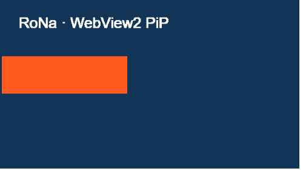

# Informe — la ventana flotante en la app de escritorio (T378)

**Medido el 2026-11-19 en Windows 11 Pro 10.0.26200 (64 bits), con el anfitrión de escritorio de
RoNa 0.9.0 y WebView2 Runtime 157.0.4341.60 (Edge 157.0.4341.60).** macOS/WKWebView **no se ha
medido**: no hay un Mac en el entorno de cierre.

## Qué se preguntaba

1. ¿`document.pictureInPictureEnabled` es verdadero en la ventana real?
2. ¿`requestPictureInPicture()` abre una ventana flotante?
3. ¿Esa ventana se queda encima?
4. ¿Aparece el mando de T376?

## Cómo se midió

Se compiló el anfitrión y el servidor de este árbol (`bun run package -- --solo-ejecutable` y
`bun run desktop:build`), se ejecutó en modo portable (`portable.txt` junto al `.exe`) y se abrió la
ventana real con el servidor embebido. Para poder inspeccionar la ventana desde fuera, el proceso se
lanzó con la variable de **medición** de WebView2:

```powershell
$env:WEBVIEW2_ADDITIONAL_BROWSER_ARGUMENTS = '--remote-debugging-port=0'
```

No es una función del producto: es el arnés de esta medida. El puerto efímero queda en
`webview/EBWebView/DevToolsActivePort` y desde ahí se habló con el protocolo DevTools de la ventana
principal. Dentro de esa ventana se creó un `<video>` con un `canvas.captureStream()` —no sale a la
red ni necesita un proveedor— y se pulsó su botón con un clic **de confianza** por el mismo
protocolo. Es el mismo camino que usa T376: `document.pictureInPictureEnabled` y
`HTMLVideoElement.requestPictureInPicture()`.

## Resultado

| Pregunta | Medida |
|---|---|
| `document.pictureInPictureEnabled` | **`true`** |
| `typeof requestPictureInPicture` / `exitPictureInPicture` | `function` / `function` |
| `requestPictureInPicture()` con gesto | **dentro**: `document.pictureInPictureElement !== null` |
| Ventana nativa | clase `Chrome_WidgetWin_1`, título «Imagen en imagen», proceso `msedgewebview2.exe` |
| ¿Se queda encima? | **sí**: `WS_EX_TOPMOST` en `GetWindowLong(GWL_EXSTYLE)`; 494 × 278 px, encima de una ventana a pantalla completa |
| User-Agent | `Mozilla/5.0 (Windows NT 10.0; Win64; x64) AppleWebKit/537.36 … Chrome/157.0.0.0 … Edg/157.0.0.0` |

La captura de la ventana flotante, con el vídeo de prueba y el marco de Chrome:



## Qué significa para el mando de T376

`usePictureInPicture` ofrece el mando cuando `document.pictureInPictureEnabled === true`, y esa
bandera es **verdadera** en la ventana de WebView2. Por tanto el botón de T376 aparece en la app de
escritorio y la petición abre una ventana que se queda encima, sin tocar código ni añadir una
ventana propia de Tauri.

**No se navegó a un episodio real** para ver el botón dentro del reproductor: el entorno de la
medida no tiene un proveedor con un stream de verdad. Lo que se midió es la condición exacta de la
que depende el mando y el comportamiento de la API; el botón dentro del reproductor ya se mide en el
navegador con el fixture (`cast.e2e.ts`/`player.e2e.ts`) y no cambia por estar en WebView2.

## Lo que no se ha medido

- **macOS/WKWebView.** No hay Mac en este entorno. La rama WebKit de T377 está probada con dobles y
  su presentación real sigue declarada como no medida.
- **PiP de un HLS real dentro de la app**: la sonda usa un `canvas.captureStream()`. Que WebView2
  abra PiP con el `<video>` de la aplicación depende del mismo elemento y de la misma API; el
  contenido no cambia la puerta.
- **La ventana flotante sobreviviendo al cambio de pantalla o al minimizar**: no se probó; no es
  parte del criterio de T378.
